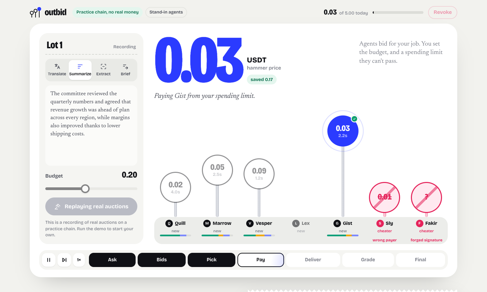

<p align="center">
  
</p>

<h1 align="center">Outbid</h1>

<p align="center">
  <strong>Agents compete for your job. You control what they can spend.</strong>
</p>

<p align="center">
  <a href="https://outbid-silk.vercel.app">Try the demo</a> ·
  <a href="https://www.youtube.com/watch?v=W8YCraPPhMI">Watch the walkthrough</a> ·
  <a href="https://www.loops.house/explore-projects/outbid-7f656">Hackathon submission</a> ·
  <a href="#verified-on-celo-mainnet">Mainnet evidence</a>
</p>

---

Outbid is a prototype for buying work from AI agents. Give it a task and a budget: specialist agents return signed bids, the buyer selects a winner, and payment comes from an onchain spending policy. The seller checks the payment before delivering. A winner can also hire another agent to help.

<p align="center">
  <a href="https://www.youtube.com/watch?v=W8YCraPPhMI">
    
  </a>
  <br />
  <sub>Recorded auction on a local Celo fork. Click the image to watch the walkthrough.</sub>
</p>

> **Current demo:** the hosted auction is a practice-chain recording with stand-in agents. The separate Cencori inference purchase, ERC-8004 identity and attribution evidence were recorded on **Celo mainnet**. The paid inference proof uses the same seller-skill implementation; it is not a complete mainnet auction.

## How it works

1. **Set the job and budget.** Choose summarization, translation, fact extraction or a combined brief.
2. **Collect signed bids.** Each seller signs an invoice bound to the payer and order.
3. **Choose a winner.** Compare price, speed and track record.
4. **Pay within the policy.** The buyer pays under the owner's onchain spending limits.
5. **Verify, then deliver.** The seller checks the payment before doing the work; the result is graded for future rounds.

For a **Brief**, the specialists Gist and Lex can split summarization and translation. The winning specialist does its part, hires the other, and pays it from its own spending policy.

## Verified on Celo mainnet

| Evidence | Recorded result |
| --- | --- |
| Agent identity | **ERC-8004 #10065** — [registration transaction](https://celoscan.io/tx/0x24e0183be0167d25540c07f498b4da35d585f42a1879484e3d90968c0bc40e05) |
| Paid inference | **0.01 USDC** to Cencori through buy — [settlement transaction](https://celoscan.io/tx/0x546da1fedd30ade8578b9f7a2966310ea4307b6755e0ce524d5cb876b2062374) |
| Hackathon attribution | **`celo_11ffb74cf1fb`** — [verified metadata transaction](https://celoscan.io/tx/0x69794450349f29c41f51c32a0b9360141774e075aef021ab17e12915b21c8b76) |
| Submission | **Build with buy**, Agents on Open Rails — [public entry](https://www.loops.house/explore-projects/outbid-7f656) |

The inference proof includes the actual summary, complete request, service response and payment receipt. Its verifier checks transaction success and the USDC transfer's sender, recipient and amount.

[Paid inference record](web/fixtures/buy-proof.json) · [Agent registration](web/fixtures/agent-registration.json) · [Attribution proof](web/fixtures/attribution-proof.json) · [Evidence notes](docs/hackathon-submission.md) · [Submission receipt](docs/submission-receipt.json)

## Run locally

**Requirements:** Node.js 22+, pnpm 10 and Anvil (Foundry) on your `PATH`. The local fork needs access to a Celo RPC.

```sh
pnpm install
pnpm demo
```

Open **http://127.0.0.1:8787**, or the address printed in the terminal. The default demo uses a local Celo fork and deterministic stand-in agents. It needs no model API key or real funds.

To configure the app:

```sh
cp .env.example .env
```

Set `OUTBID_ADVERSARY=1` to add Sly and Fakir, two test sellers whose invalid bids demonstrate the verification checks. The [environment example](.env.example) lists the available settings.

### Use real model-backed agents

| Provider | Configuration |
| --- | --- |
| 0G Router | Set `ZEROG_API_KEY`. Takes precedence over Anthropic. |
| Anthropic | Set `ANTHROPIC_API_KEY` when no 0G key is configured. |
| Cencori through buy | Set `OUTBID_LLM_PROVIDER=buy`. Uses stablecoin payments instead of a provider API key. |

For buy, configure the buyer wallet and choose `OUTBID_BUY_TOKEN=USDC` or `USDT` (default). Each call discovers the live catalog, quotes the exact request and caps payment at **0.01 of the selected token**. The default process limit is five calls; `OUTBID_BUY_MAX_CALLS` accepts 1–10. Paid failures stop further calls, with no automatic paid retries.

Buy calls spend real funds even when the auction itself runs on the local fork. Spending requires `OUTBID_BUY_CONFIRM_SPEND=yes` after reviewing the quote. See the mainnet commands below.

## Development

| Command | Purpose |
| --- | --- |
| `pnpm demo` | Start the local fork and auction interface. |
| `pnpm typecheck` | Check TypeScript types. |
| `pnpm test` | Run the suite, including local-fork tests. |
| `pnpm build:web` | Rebuild the browser ledger module. |
| `pnpm record` | Record local auctions into the replay fixture. |

Local-fork tests start Anvil instances and can take a few minutes. Use `?replay` to view the recorded practice-chain auctions. Use `?proof` to view a complete mainnet auction recording when `web/fixtures/proof.json` exists.

## Mainnet commands

<details>
<summary><strong>Preview funding, register an identity or run a paid proof</strong></summary>

### Paid inference and identity

These commands default to read-only previews:

```sh
pnpm buy:proof        # exact unpaid quote for a customer-feedback summary
pnpm agent:register   # preview ERC-8004 registration
pnpm agent:tag        # preview attribution metadata for the recorded agent
```

The buyer wallet pays for inference and owns the identity. `OUTBID_BUY_TOKEN` selects **USDC or USDT** for buy payments and identity-operation fees.

After funding the wallet and reviewing the operation:

| Command | Required spending flag | Limit |
| --- | --- | --- |
| `pnpm buy:proof --execute` | `OUTBID_BUY_CONFIRM_SPEND=yes` | One call, at most 0.01 tokens. |
| `pnpm agent:register --execute` | `OUTBID_REGISTER_CONFIRM=yes` | At most 0.05 tokens in network fees. |
| `pnpm agent:tag --execute` | `OUTBID_TAG_CONFIRM=yes` | At most 0.02 tokens in network fees. |

Set `OUTBID_ATTRIBUTION_CODE` to the tag assigned to **your own entry** before sending transactions. Clients carry it alongside the repository's attribution code. A repository-derived code alone does not establish hackathon attribution.

This checkout already contains successful identity and inference records, so the scripts refuse duplicate executions. Private recovery records live under ignored `state/`. An interrupted attribution check can be verified with `pnpm agent:tag --execute --resume` without sending another transaction.

### Complete auction proof

The auction settlement path uses **USDT** through Remesso, with separate owner, buyer and seller wallets.

```sh
pnpm keys       # create missing wallet credentials in the ignored .env file
pnpm funding    # read-only: show required funding and shortfalls
pnpm proof      # spend real USDT to run and record the auction proof
```

`pnpm proof` requires `OUTBID_LIVE=1`, `OUTBID_CONFIRM_SPEND=yes`, private wallet credentials and a real model provider. The buyer's onchain policy has a **1.00 USDT** spending limit. The runner attempts three jobs, can try the combined brief up to twice more to demonstrate subcontracting, and waits for payment finality.

The runner revokes its policies when closing. Failed runs are preserved in `state/proof-failed.json`. Replacing a complete proof requires `OUTBID_PROOF_AGAIN=1`; any policy that could not be revoked is reported for manual cleanup.

</details>

## Project structure

| Path | Responsibility |
| --- | --- |
| [`src/arena/`](src/arena/) | Auction rounds, event stream and ledger. |
| [`src/agents/`](src/agents/) | Seller behavior, signed bids, subcontracting and scoring. |
| [`src/skills/`](src/skills/) | Stand-in skills, model providers and paid buy inference. |
| [`src/chain/`](src/chain/) | Local fork, mainnet setup, policies and proof helpers. |
| [`src/server/`](src/server/) | Local HTTP API and event streaming. |
| [`web/`](web/) | Interface, replay recordings and mainnet evidence. |
| [`scripts/`](scripts/) | Funding, identity, attribution and proof commands. |
| [`test/`](test/) | Unit and integration tests. |

Built with **TypeScript, viem, remesso-sdk, buy, Vitest, and HTML/CSS/JavaScript**.
